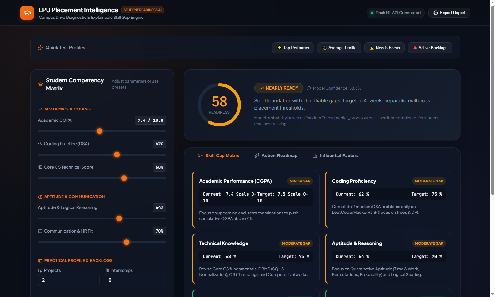
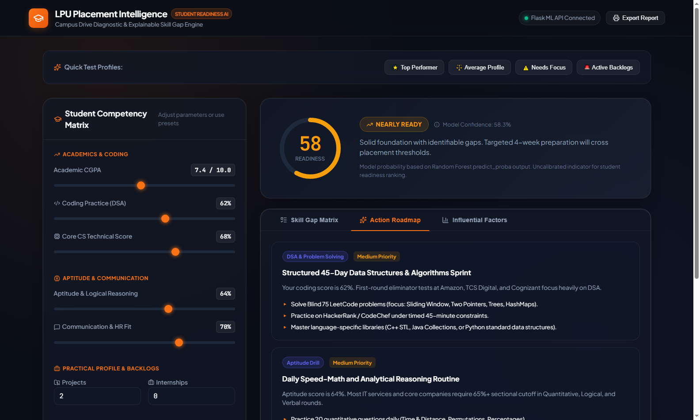
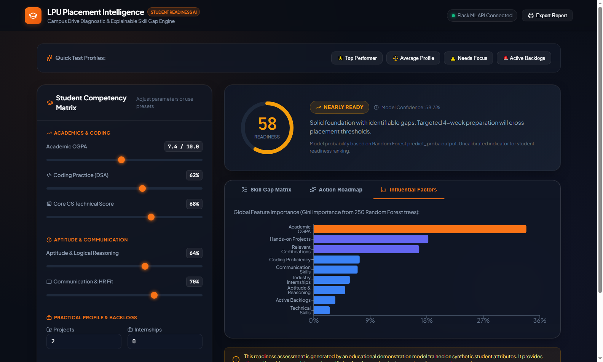

<div align="center">

# 🎓 LPU Placement Intelligence
### Student Readiness Prediction & Skill Gap Analysis Platform

[](https://python.org)
[](https://flask.palletsprojects.com)
[](https://vitejs.dev)
[](https://scikit-learn.org)
[](LICENSE)

<br/>

> **Built with ❤️ by [PRAVEEN](https://github.com/PRAVEEN-LPU)**

<br/>

An end-to-end **Machine Learning web application** designed to evaluate a student's preparedness for campus placement drives, identify specific skill gaps against institutional benchmarks, and generate transparent, actionable improvement roadmaps.

</div>

---

## 📸 Application Screenshots

<table>
<tr>
<td align="center" width="50%">

<br/><b>🏠 Main Dashboard — Student Competency Matrix</b>
</td>
<td align="center" width="50%">

<br/><b>🔍 Skill Gap Matrix — Gap Severity Analysis</b>
</td>
</tr>
<tr>
<td align="center" width="50%">

<br/><b>🗺️ Personalized Action Roadmap</b>
</td>
<td align="center" width="50%">

<br/><b>📊 Influential ML Factors Chart</b>
</td>
</tr>
<tr>
<td align="center" colspan="2">

<br/><b>🔴 Needs Focus — Profile Analysis View</b>
</td>
</tr>
</table>

---

## 🌟 Key Features

| Feature | Description |
|---|---|
| 🎛️ **Competency Matrix Dashboard** | Interactive sliders for 9 student parameters with live sync |
| 🤖 **ML Inference Engine** | Random Forest (250 trees) with 91% accuracy & 0.97 AUC |
| 🔍 **Skill Gap Matrix** | Compares student params against placement cutoffs |
| 🗺️ **Action Roadmap** | Prioritized 30–60 day improvement plans |
| 📄 **Report Export** | Print-optimized diagnostic scorecard |
| ⚡ **Quick Presets** | One-click: Top Performer / Average / Needs Focus / Backlogs |

### 🤖 Model Performance

| Metric | Value |
|---|---|
| ✅ Accuracy | **91.00%** |
| 📈 ROC-AUC | **0.9724** |
| 🎯 F1-Score | **91.49%** |

---

## 📁 Repository Structure

```text
LPU-Placement-Intelligence/
├── backend/                           # 🐍 Python Flask & Machine Learning
│   ├── app.py                         # REST API server (Port 5000)
│   ├── model.py                       # ML models, synthetic generator, skill gaps
│   ├── train_model.py                 # Standalone model training script
│   ├── train_kaggle.py                # Kaggle dataset training script
│   ├── placement_model.joblib         # Pre-trained model binary artifact
│   ├── test_api.py                    # Automated API test suite
│   └── requirements.txt              # Python package dependencies
│
├── frontend/                          # ⚛️ React + Vite Dashboard
│   ├── src/
│   │   ├── App.jsx                    # Interactive dashboard component
│   │   ├── style.css                  # Modern UI & responsive styling
│   │   └── main.jsx                   # React root mount
│   ├── index.html                     # Web entry point
│   ├── package.json                   # React, Vite, Recharts, Lucide deps
│   └── vite.config.js                 # Vite server & API proxy config
│
├── dataset/                           # 📊 Training datasets
├── screenshots/                       # 🖼️ Application screenshots
├── brain/                             # 📋 Project blueprints & architecture docs
├── .gitignore
└── README.md
```

---

## ⚙️ Prerequisites

Make sure you have these installed before running:

| Requirement | Version | Download |
|---|---|---|
| Python | 3.10+ | [python.org](https://www.python.org/downloads/) |
| Node.js | 18+ | [nodejs.org](https://nodejs.org/) |
| npm | 9+ | Comes with Node.js |
| Git | Any | [git-scm.com](https://git-scm.com/) |

---

## 🚀 Complete Setup & Run Guide

### Step 1 — Clone the Repository
```bash
git clone https://github.com/PRAVEEN-LPU/LPU-Placement-Intelligence.git
cd LPU-Placement-Intelligence
```

---

### Step 2 — Backend Setup (Python + Flask)

> Open **Terminal 1** and run these commands:

```bash
# Navigate to backend folder
cd backend

# Create a Python virtual environment
python -m venv .venv

# Activate the virtual environment
# On Windows (PowerShell):
.\.venv\Scripts\Activate.ps1

# On Windows (Command Prompt):
.\.venv\Scripts\activate.bat

# On macOS / Linux:
source .venv/bin/activate

# Install all Python dependencies
pip install -r requirements.txt

# Start the Flask API server
python app.py
```

✅ Flask API will start at: `http://127.0.0.1:5000`  
✅ Health check: `http://127.0.0.1:5000/api/health`

---

### Step 3 — Frontend Setup (React + Vite)

> Open **Terminal 2** and run these commands:

```bash
# Navigate to frontend folder (from project root)
cd frontend

# Install Node.js dependencies
npm install

# Start the React development server
npm run dev
```

✅ React app will open at: `http://localhost:5173`

---

### Step 4 — Open the App

Go to your browser and open:
```
http://localhost:5173
```

🎉 **The LPU Placement Intelligence dashboard is now live!**

---

## 🧪 Run Automated API Tests

To verify all backend endpoints are working correctly:

```bash
# Make sure backend is running first (Step 2)
# Then in the backend folder:
cd backend
.\.venv\Scripts\python.exe test_api.py
```

---

## 🔁 Re-train the Machine Learning Model

If you want to retrain the ML model from scratch:

```bash
cd backend

# Activate virtual environment first (see Step 2)

# Option 1: Train on synthetic data
python train_model.py

# Option 2: Train on Kaggle campus recruitment dataset
python train_kaggle.py
```

---

## 📡 API Endpoints Reference

| Method | Endpoint | Description |
|---|---|---|
| `GET` | `/api/health` | Server health check |
| `POST` | `/api/predict` | Get ML placement prediction |
| `POST` | `/api/skill-gap` | Get skill gap analysis |
| `POST` | `/api/roadmap` | Get personalized action roadmap |

### Example API Request
```bash
curl -X POST http://127.0.0.1:5000/api/predict \
  -H "Content-Type: application/json" \
  -d '{
    "cgpa": 8.5,
    "coding_score": 80,
    "technical_score": 75,
    "aptitude_score": 72,
    "communication_score": 85,
    "projects": 4,
    "internships": 1,
    "certifications": 3,
    "backlogs": 0
  }'
```

---

## 🛠️ Tech Stack

| Layer | Technology |
|---|---|
| **Frontend** | React 18, Vite, Recharts, Lucide Icons |
| **Backend** | Python 3.10, Flask, Flask-CORS |
| **ML Library** | Scikit-learn, NumPy, Pandas |
| **Model** | Random Forest Classifier (250 estimators) |
| **Styling** | Custom CSS with dark theme |
| **API** | RESTful JSON API |

---

## ⚠️ Educational Disclaimer

This platform utilizes a reproducible **synthetic demonstration dataset** modeling student performance distributions for training purposes. Predictions represent diagnostic readiness indicators and **do not constitute** a legal, formal, or institutional guarantee of campus recruitment outcomes.

---

## 📜 License

This project is licensed under the **MIT License**.

You are free to use, modify, and distribute this project **with attribution**.

> ⚠️ **Important:** Any use, fork, or distribution of this project **must retain the original author credit**:
> 
> **Created by [PRAVEEN](https://github.com/PRAVEEN-LPU)**

---

<div align="center">

### Made with 🔥 by [PRAVEEN](https://github.com/PRAVEEN-LPU)

[](https://github.com/PRAVEEN-LPU)

*If you use or fork this project, please keep the author's name intact. Attribution matters!*

</div>
